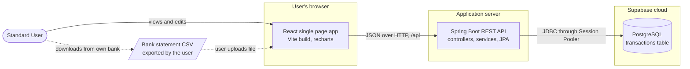
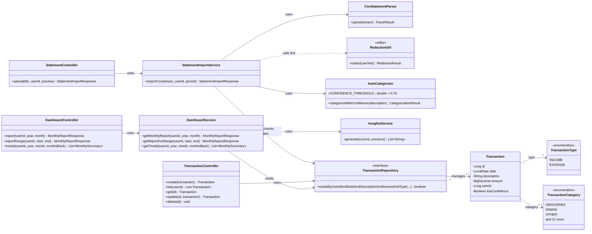
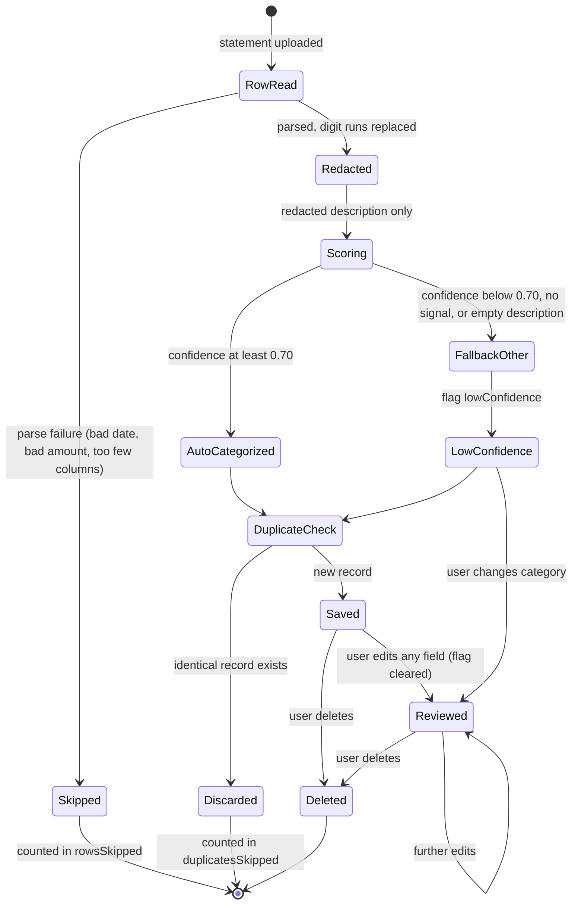
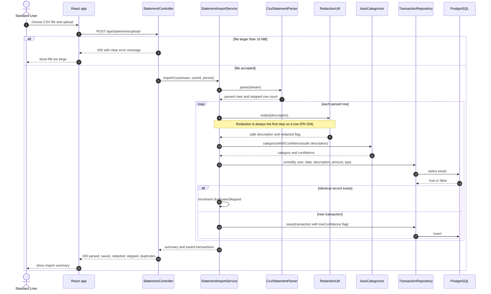
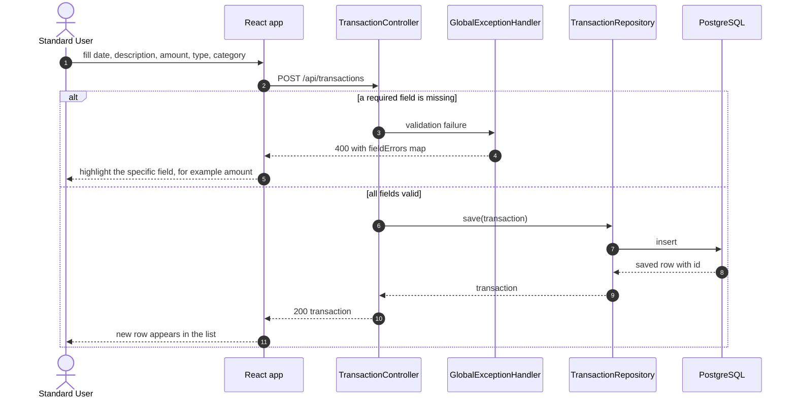
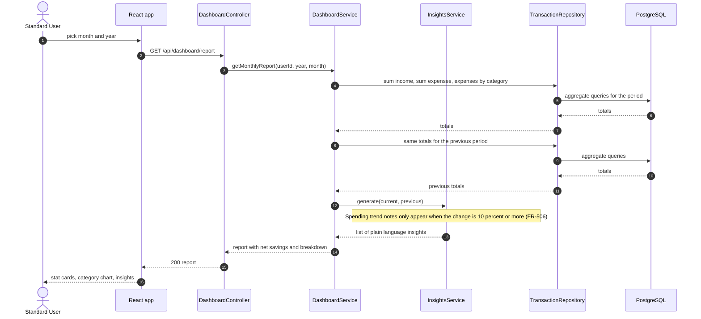
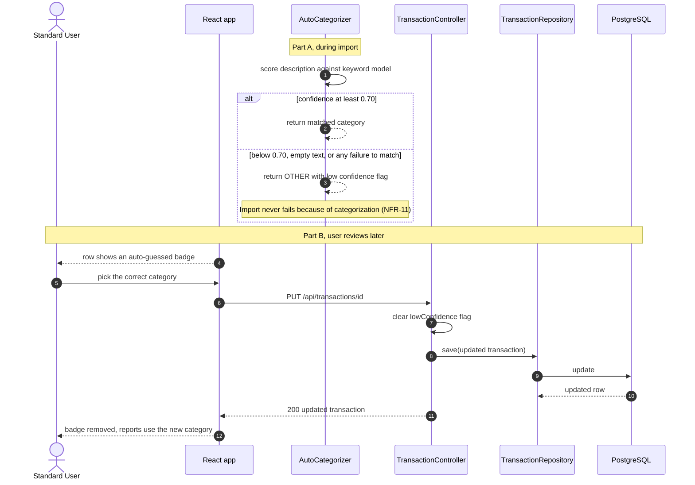
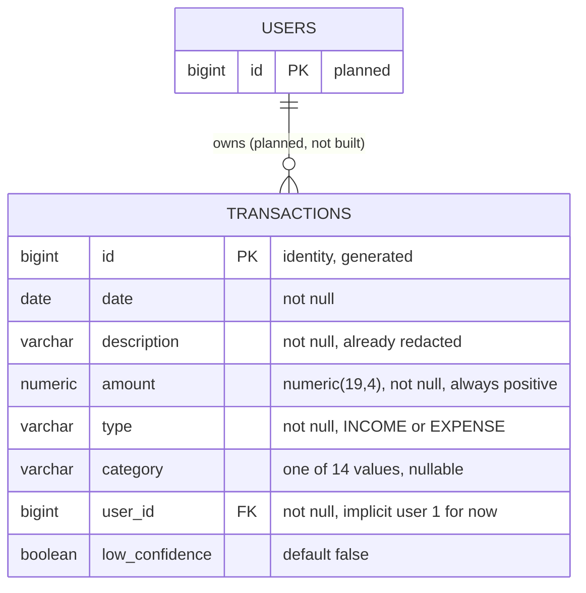
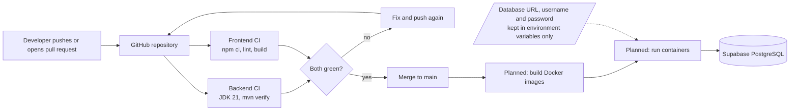
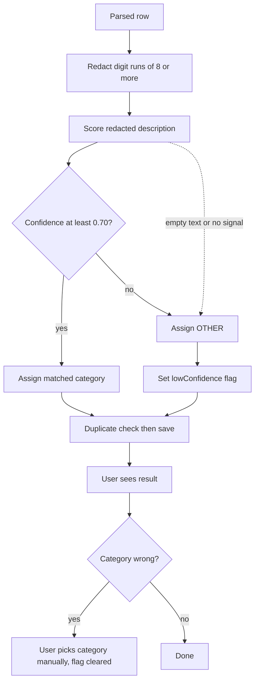

# KnowYourFinance: Milestone 3, Formal Analysis and Design Document

**Course:** COMP 425, Software Engineering, Fall 2026
**Instructor:** Dr. Mohammad Shahab
**Document date:** October 23, 2026
**Baseline:** [Milestone 2 SRS](../requirements/milestone-2-srs.md) (requirement IDs below are the real IDs from that document)
**Diagram sources:** every diagram in this document is also stored as a standalone file in [`docs/diagrams/`](../diagrams/) so it can be edited and versioned on its own.

---

## 1. Title page

| Item | Value |
|---|---|
| Project | KnowYourFinance (KYF) |
| Milestone | 3, Formal Analysis and Design |
| Repository | https://github.com/rayamajhianirudra-droid/knowyourfinance |
| Release tag | `milestone-3` (to be created when the team confirms this document is final) |

| Team member | Project role |
|---|---|
| AJ Rayamajhi | To be confirmed by the team |
| Ayush Gaire | To be confirmed by the team |
| Sujal Rao | To be confirmed by the team |
| Abdul Mughees | To be confirmed by the team |

---

## 2. Executive summary

KnowYourFinance is a personal budgeting tool for a person who wants to understand what they earned, spent and saved over any period without connecting a live bank account. The user exports a statement from their bank as a CSV file, uploads it, and the system turns each row into a categorized transaction. Cash spending that never appears on a statement can be added by hand. The user can then open an income versus expense report for any month, year or custom date range, a multi month trend, and a short list of plain language observations comparing the period to the one before it.

The system's AI feature is automatic categorization. Each imported transaction description is scored against a keyword model and assigned one of 14 categories. A score of at least 0.70 is accepted. Anything lower is assigned the fallback category OTHER and flagged so the user can see it was an unreviewed guess. The user can always change a category by hand, and doing so clears the flag.

Three design decisions shape everything else:

1. **Redact first, then do anything else.** Account, routing and card number patterns are replaced with a placeholder as the very first step applied to a parsed row, so no later step (categorization, duplicate check, storage, logging) can ever see the original digits.
2. **Never block the user on the AI step.** The categorizer always returns a category. When it is unsure it returns OTHER with a low confidence flag instead of failing, and every category is editable.
3. **Keep the layers separate.** A React single page application talks only to a Spring Boot REST API, and only the API talks to the PostgreSQL database hosted on Supabase. Presentation, business rules and storage each have one owner.

---

## 3. Changes since Milestone 2

The Milestone 2 SRS is the baseline. No functional requirement was added or dropped. The changes below are implementation level or close gaps between the SRS and the running system.

| Area | Change | Reason |
|---|---|---|
| FR-403, FR-404 | The Transactions page now supports editing every field of a transaction and deleting one. The API already supported both, but the user interface did not expose them. | An audit of the running app against the SRS found these two requirements unmet from the user's point of view. |
| FR-302, FR-303 | The categorizer now returns a numeric confidence, and transactions carry a `lowConfidence` flag shown in the UI. | The SRS specified a 0.70 threshold but the first implementation had no score to compare against it. |
| FR-104 | The import summary now reports an accurate skipped row count. | It was previously hardcoded to zero. |
| FR-501 | Added a custom date range report (`/api/dashboard/report-range`) in addition to month and year. | Supports the product's main differentiator of reporting over any chosen period. It extends FR-501 and does not replace it. |
| NFR-07 | Persistence moved from a local H2 file to PostgreSQL hosted on Supabase. | Data now survives restarts and is ready for cloud deployment in Milestone 4. |
| Out of scope items | Unchanged: authentication, budgets, recurring charge detection, export, multi currency, bank linking. | SRS section 1.4 keeps them out of the MVP. |

---

## 4. System architecture (container view)

**Question this diagram answers:** what are the separately deployable pieces of the system, and who is allowed to talk to whom? It supports the privacy requirements FR-201 and NFR-05 directly: there is no box that connects to a bank, so there is no path by which credentials could arrive.

---

## 5. Structural design

### 5.1 Class diagram

The backend follows three layers: controllers accept HTTP requests, services hold business rules, and one repository talks to the database. `RedactionUtil` is a static helper, not a service object, so it cannot be bypassed by dependency injection.

### 5.2 State diagram: life of a transaction

This diagram shows what can happen to a statement row and what state a saved transaction can be in. It includes the failure paths: a row that cannot be parsed, a duplicate, and a categorizer that cannot produce a confident answer.

---

## 6. Behavioral design (sequence diagrams)

Four scenarios, each with its use case ID from the SRS, preconditions and the requirements it exercises.

### 6.1 Import a statement (UC1, includes UC2)

**Preconditions:** the user has a CSV file with date, description and amount columns, and the backend is running.
**Requirements:** FR-101 to FR-106, FR-201 to FR-205, FR-301, NFR-03, NFR-06, NFR-08.

### 6.2 Add a manual transaction (UC4)

**Preconditions:** the user is on the manual entry form.
**Requirements:** FR-401, FR-405, NFR-09.

### 6.3 View a month report with insights (UC6, includes UC8)

**Preconditions:** the user has chosen a month and year, a custom range, or a trend length.
**Requirements:** FR-501 to FR-506, NFR-01.

### 6.4 Low confidence category and manual override (UC3, AI fallback)

**Preconditions:** an imported transaction was assigned OTHER because the categorizer was not confident.
**Requirements:** FR-303, FR-304, FR-306, FR-403, NFR-11.

---

## 7. Data design (entity relationship diagram)

The MVP has one table. Keys, constraints and indexes are listed under the diagram. `user_id` is a plain column for now because authentication is out of scope (SRS 1.4, item 3). The `USERS` entity is shown only to make the planned relationship visible and does not exist yet.

| Item | Detail |
|---|---|
| Primary key | `transactions.id`, identity column |
| Foreign key | `transactions.user_id` will reference `users.id` once accounts exist. No database level constraint exists today. |
| Check constraints | `type` limited to INCOME and EXPENSE, `category` limited to the 14 enum values (applied in the Supabase schema) |
| Indexes | `user_id` and `date`, because every report filters by user and date range |
| Money | `numeric(19,4)` mapped to `BigDecimal`, never floating point |
| Duplicates | Detected by the repository query on user, date, description, amount and type before insert. No unique constraint backs it yet (see risks). |

---

## 8. Deployment and DevOps

### 8.1 Environments

| Environment | What runs | Database |
|---|---|---|
| Developer machine | `mvn spring-boot:run` on port 8080 and `npm run dev` on port 5173 | Supabase project (shared hosted database) |
| CI (GitHub Actions) | Backend CI builds with JDK 21 and runs all tests. Frontend CI installs, lints and builds. | None needed, tests are unit tests with mocks |
| Planned for Milestone 4 | Backend and frontend as Docker images run together with Docker Compose | Supabase project |

### 8.2 Pipeline and secrets

**Where secrets live:** the database password is read from the `SPRING_DATASOURCE_PASSWORD` environment variable and has no default value, so the backend refuses to start without it. No secret is committed to the repository. The bank login problem does not exist at all, since the system never collects bank credentials.

---

## 9. AI feature design

**What it does:** assigns one of 14 spending categories to each imported transaction from its redacted description (FR-301).

**Model and approach:** a deterministic, rule based keyword model (`AutoCategorizer`). An ordered map of keywords to categories is checked against the lower cased description. A match scores 0.85. No match scores 0.0. The threshold is 0.70 (FR-302). This is a deliberate choice for the MVP, explained in section 10, and the class has a single entry point (`categorizeWithConfidence`) so a learned model could replace it later without changing any caller.

**Input:** only the redacted description. The original text never reaches this step (FR-305).

**Failure handling:**

| Situation | Behavior |
|---|---|
| No keyword matches | OTHER with the low confidence flag (FR-303) |
| Empty or unreadable description | OTHER with the low confidence flag (FR-304) |
| Any inability to decide | OTHER, never an exception that aborts the import (NFR-11) |
| Wrong guess | User changes the category at any time (FR-306) |

**What the user sees:** low confidence rows show an "auto-guessed" badge. Once the user edits the row, the badge disappears because a person has now reviewed it.

**Privacy and ethics:** nothing leaves the server for categorization, because the keyword model runs inside the application. If a hosted language model is added later, only the redacted description may be sent, never the amount, date or any identifier. The category is a suggestion and never changes money, only how spending is grouped, so a wrong guess has low impact and is fully reversible.

---

## 10. Design decisions

| Decision | Alternatives considered | Reason |
|---|---|---|
| Never connect to a bank, import CSV exports instead | Aggregator services that link accounts | Removes credential storage and a whole class of security risk. Costs real time syncing, which is accepted. |
| Redact before any other processing | Redact only before display, or only before storage | Doing it first means no later code path can store, log or score the original digits (FR-204, NFR-03). |
| Keyword categorizer with a confidence score | Hosted language model, trained classifier | Free, instant, private, testable and explainable. Fits the 0.70 threshold and fallback rules. Replaceable later behind one method. |
| Fall back to OTHER instead of failing | Reject the row, or leave it uncategorized | Keeps imports complete and reports consistent (NFR-11). |
| PostgreSQL on Supabase | Local H2 file, self hosted Postgres | Data survives restarts, works from any machine, ready for deployment. Replaced H2 in build log 16. |
| `BigDecimal` and `numeric(19,4)` for money | `double` | Avoids rounding errors in totals. |
| Separate React SPA and REST API | Server rendered pages | Clear boundary, each side can be tested and deployed on its own. |
| Edit rows inline, confirm deletes with two clicks | Modal dialogs, browser confirm box | Keeps the surrounding table visible and avoids a second form that duplicates validation. |
| Single implicit user for the MVP | Build authentication now | SRS 1.4 defers it. `user_id` is already on every row so adding accounts later is a schema addition, not a rewrite. |
| Duplicate detection by repository query | Unique database constraint | Allows two genuinely identical purchases to be reported clearly. A constraint is listed as future work. |

---

## 11. Requirements traceability matrix

Rows use the real Milestone 2 IDs.

| Requirement | Diagram | Class or endpoint | Table or column |
|---|---|---|---|
| FR-101, FR-102 | 6.1 | `StatementController`, `CsvStatementParser` | none |
| FR-103, FR-104 | 5.2, 6.1 | `CsvStatementParser.ParseResult`, `StatementImportResponse` | none |
| FR-105, NFR-06 | 6.1 | `GlobalExceptionHandler`, multipart limit 10 MB | none |
| FR-106 | 5.2, 6.1 | `TransactionRepository.existsBy...` | `transactions` (user, date, description, amount, type) |
| FR-201, NFR-05 | 4 | no credential input exists anywhere | none |
| FR-202, FR-203 | 6.1, 9 | `RedactionUtil` | `transactions.description` |
| FR-204, NFR-03, NFR-04 | 6.1 | `StatementImportService` calls `RedactionUtil` first | `transactions.description` |
| FR-205 | 6.1 | `StatementImportResponse.rowsRedacted` | none |
| FR-301, FR-302 | 5.2, 6.4, 9 | `AutoCategorizer` | `transactions.category` |
| FR-303, FR-304, NFR-11 | 5.2, 6.4, 9 | `AutoCategorizer`, `TransactionCategory.OTHER` | `transactions.low_confidence` |
| FR-305 | 6.1, 9 | `StatementImportService` ordering | none |
| FR-306 | 6.4 | `TransactionController.update` | `transactions.category` |
| FR-401, FR-405, NFR-09 | 6.2 | `TransactionController.create`, `GlobalExceptionHandler` | `transactions` |
| FR-402 | 6.2 | `TransactionController.list` | `transactions` |
| FR-403 | 5.2, 6.4 | `TransactionController.update`, `TransactionList` component | `transactions` |
| FR-404 | 5.2 | `TransactionController.delete`, `TransactionList` component | `transactions` |
| FR-501, FR-502, FR-503 | 6.3 | `DashboardController.report`, `DashboardService` | `transactions.date`, `amount`, `type`, `category` |
| FR-504 | 6.3 | `DashboardController.trends` | `transactions` |
| FR-505, FR-506 | 6.3 | `InsightsService` | none |
| NFR-01, NFR-02 | 6.1, 6.3 | indexes on `user_id` and `date` | indexes |
| NFR-07, NFR-08 | 7, 8 | Supabase PostgreSQL, per row error handling in the parser | `transactions` |
| NFR-10 | none | frontend income and expense styling | none |

---

## 12. Risks and open questions

| Risk or question | Impact | Plan |
|---|---|---|
| Duplicate detection has no database constraint, so two simultaneous uploads could both pass the check | Possible duplicate rows | Add a unique index or run imports one at a time per user |
| The keyword model only knows merchants in its list | More rows land in OTHER | Grow the list from real statements, consider a learned model later |
| No authentication, every request acts as user 1 | Not safe to expose publicly yet | Add accounts before any public deployment |
| Row level security is off on the Supabase table | Fine while only the backend connects, unsafe if the database is ever exposed directly | Keep the backend as the only client, revisit with accounts |
| Statement formats differ by bank | Some CSV layouts fail to parse | Parser skips and counts bad rows, add column mapping later |
| Backend cannot be built on every developer machine without Maven on the path | Slower onboarding | Docker in Milestone 4 removes the local toolchain requirement |
| Open question: which hosting service for Milestone 4 | Affects the deployment plan | Team to choose |
| Open question: should the milestone-3 tag be created before or after the instructor's feedback | Release process | Team to confirm |

---

## 13. Team contributions

Individual authorship has not been confirmed by the team, so no one is credited here yet. Each member should fill in their own row before submission.

| Member | Sections and diagrams authored | Code contributions |
|---|---|---|
| AJ Rayamajhi | To be confirmed | To be confirmed |
| Ayush Gaire | To be confirmed | To be confirmed |
| Sujal Rao | To be confirmed | To be confirmed |
| Abdul Mughees | To be confirmed | To be confirmed |
